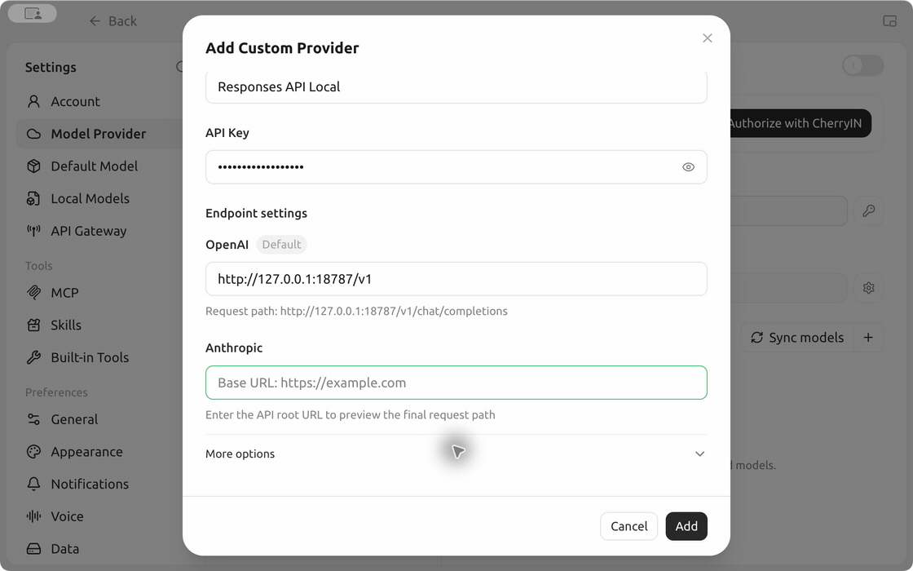

# Responses API Local

Run a local API gateway from your Mac’s menu bar. Connect your ChatGPT account, then use its available models from Cherry Studio or another desktop client with a custom provider.

**[Build and install](#build-and-install)** · **[Cherry Studio tutorial](docs/cherry-studio.md)**



## Build and install

Use an Apple Silicon Mac with macOS 15 or later, the Xcode Command Line Tools, and Python 3.

[Download the source ZIP](https://github.com/guardnetwork/responses-api-local/archive/refs/heads/main.zip), extract it, and run this command from the extracted directory.

```sh
./build.sh
```

Open the disk image in `Release/` and drag **Responses API** to **Applications**. Node.js and the proxy are bundled with the app. To check the disk image, run `shasum -a 256 -c Responses-API-1.4.8-arm64.dmg.sha256` from `Release/`.

## Get started

1. Open **Responses API** and select **Connect Account**. Finish device authorization in your browser.
2. Select **Test Combination** to verify the default model and reasoning effort, GPT‑6.1 Sol and low.
3. Copy the Base URL and local API key into your desktop client. Choose `local-default` to use the app’s current defaults.

The gateway listens on loopback and supports OpenAI Responses, OpenAI Chat Completions, and Anthropic-compatible Messages. Your client needs a custom Base URL and a compatible protocol. See [model selection](MODEL-SELECTION.md) for per-request overrides, aliases, and protocol limits.

Close the window to keep the service running in the menu bar. Reopen it from the menu bar, or quit the app to stop the gateway.

## License

[MIT](LICENSE) · [Third-party notices](ThirdParty/Notices/THIRD_PARTY_NOTICES.md)
