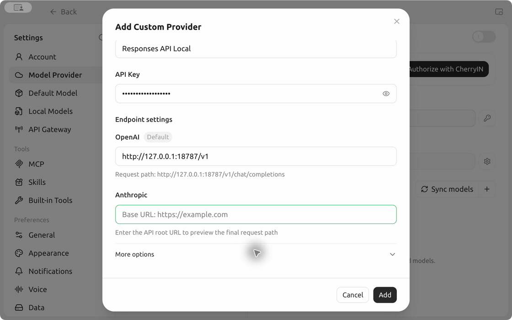

# Connect Cherry Studio to Responses API Local

Tested with Cherry Studio **2.2.0** and the **1.4.8** Responses API Local gateway on Apple Silicon macOS 15.7.7. A real Chat request through the OpenAI-compatible endpoint returned HTTP 200 and displayed a streamed reply in Cherry Studio.

## Add the provider

1. In Responses API, select **Connect Account** and complete browser authorization. When the API service is running, select **Test Combination** and wait for the default combination to verify. Copy the **OpenAI** Base URL and the local **API key** from the app.
2. In Cherry Studio, open **Settings → Model Provider → Add Provider**. Name it `Responses API Local`. Paste your local key in **API Key** and the copied URL in the **OpenAI** field. The URL ends in `/v1`. The request preview should end in `/v1/chat/completions`.
3. Select **Add**, check **Local Default** (`local-default`), then select **Add selected models**. Wait for **Verify Local Default** and **Enable provider** to show **Success**, then select **Done**.

## Send a chat message

1. Return to **Chat** and open the model picker in the chat header.
2. Choose **Local Default** under **Responses API Local**.
3. Send a prompt such as `Reply with a short greeting.` The reply appears as it streams.

The demo uses the example Base URL `http://127.0.0.1:18787/v1` and a placeholder key. Use the values from your own gateway for actual requests.

## Compatibility and usage

- This walkthrough uses ordinary **Chat** over OpenAI-compatible Chat Completions. Cherry Studio’s Work mode and its hosted tools are outside the tested setup.
- If **Local Default** is missing, verify the app’s default combination and sync the provider’s models again. For a different model and reasoning effort, select a verified [combination alias](../MODEL-SELECTION.md). The client’s output-token setting is not enforced by this gateway’s upstream connection.
- The live test verified model discovery, provider verification, and a streamed chat reply with GPT‑6.1 Sol at low effort. It did not measure the account’s remaining allowance, request budget, or reset time. See your account’s usage dashboard and the [OpenAI Codex usage guide](https://help.openai.com/en/articles/11369540-using-codex-with-your-chatgpt-plan).
